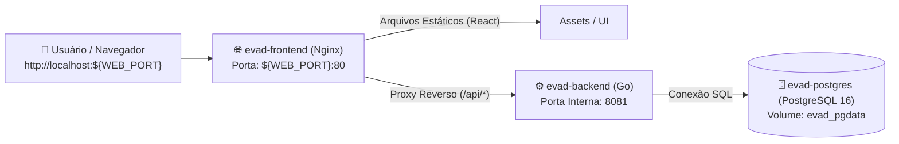

# 🐳 Guia de Execução no Docker — EVAD Intelligence

Este guia explica passo a passo como subir e operar o **EVAD** em ambiente Docker local ou em servidor de produção.

---

## 📋 1. O que você precisa ter instalado (Pré-requisitos)

Para rodar o EVAD via Docker, você só precisa de:
* **Docker Desktop** (no Windows ou macOS) OU **Docker Engine + Docker Compose** (no Linux).

> [!NOTE]
> **Você NÃO precisa instalar Go, Node.js nem PostgreSQL na sua máquina hospedeira.**
> Toda a compilação, banco de dados e servidores web rodam 100% isolados dentro dos containers Docker.

---

## ⚙️ 2. Como Definir a Porta Web via Variável de Ambiente

A porta que você usa no navegador para abrir o sistema é configurada no arquivo **`.env`** na raiz do projeto:

1. Abra o arquivo **`.env`** (ou copie de `.env.example` caso ainda não exista):
   ```env
   # Defina aqui a porta desejada no seu navegador (Host)
   WEB_PORT=80
   ```

2. **Exemplos de portas:**
   * Se você deixar `WEB_PORT=80`, você acessará: `http://localhost`
   * Se você colocar `WEB_PORT=3000`, você acessará: `http://localhost:3000`
   * Se você colocar `WEB_PORT=8080`, você acessará: `http://localhost:8080`
   * Se você colocar `WEB_PORT=5173`, você acessará: `http://localhost:5173`

> [!TIP]
> Caso a porta 80 já esteja em uso por outro serviço na sua máquina (como IIS ou Apache), basta alterar para `WEB_PORT=3000` e rodar `docker compose up -d`.

---

## 🚀 3. Passo a Passo para Subir o EVAD

Abra o terminal (PowerShell, CMD ou Bash) na pasta do projeto e execute:

### Passo 1: Construir e iniciar os containers
```bash
docker compose up -d --build
```

O Docker irá automaticamente:
1. Subir o container do **PostgreSQL 16** com volume persistente.
2. Executar as migrações automáticas de banco de dados (`backend/migrations/`).
3. Compilar o binário em Go do **evad-backend** e iniciar a API.
4. Compilar os arquivos estáticos do **evad-frontend** e subir o servidor web **Nginx com Proxy Reverso**.

### Passo 2: Acessar no Navegador
Após alguns segundos, abra o navegador e acesse:
👉 **`http://localhost`** *(ou a porta que você definiu em `WEB_PORT`)*

---

## 🧱 4. Arquitetura dos Containers

A stack do EVAD é composta por 3 serviços orquestrados na rede interna `evad-net`:



* **`evad-frontend` (Nginx):** Entrega a aplicação React compilada em alta performance e faz o roteamento transparente de todas as chamadas `/api/*` diretamente para o backend. Não há problemas de CORS.
* **`evad-backend` (Go):** API REST de alta velocidade para cálculo de coortes, importação de planilhas e integração com API RBX.
* **`evad-postgres` (PostgreSQL 16 Alpine):** Armazena com segurança todos os contratos, eventos de bloqueio e configurações. Os dados são salvos no volume `evad_pgdata` e **nunca são perdidos**, mesmo ao reiniciar o Docker.

---

## 🛠️ 5. Comandos Úteis do Dia a Dia

### Ver status dos containers
```bash
docker compose ps
```

### Ver logs em tempo real
```bash
# Todos os containers
docker compose logs -f

# Apenas backend
docker compose logs -f evad-backend

# Apenas frontend/nginx
docker compose logs -f evad-frontend
```

### Reiniciar após alterar código
```bash
docker compose up -d --build
```

### Parar os containers sem perder dados
```bash
docker compose down
```

### Fazer Backup do Banco de Dados
Para salvar um backup completo de todos os contratos em um arquivo `.sql`:
```bash
docker exec -t evad-postgres pg_dump -U evad_user evad_db > backup_evad.sql
```

### Restaurar Backup do Banco de Dados
```bash
cat backup_evad.sql | docker exec -i evad-postgres psql -U evad_user -d evad_db
```
*(No PowerShell Windows: `Get-Content backup_evad.sql | docker exec -i evad-postgres psql -U evad_user -d evad_db`)*

---

## 🔒 6. Variáveis de Ambiente Disponíveis (`.env`)

| Variável | Valor Padrão | Descrição |
| :--- | :---: | :--- |
| `WEB_PORT` | `80` | Porta externa onde a interface web será acessada no navegador |
| `BACKEND_PORT` | `8081` | Porta direta da API Go (opcional para testes) |
| `DB_PORT` | `5433` | Porta externa do PostgreSQL para acesso via DBeaver / pgAdmin |
| `DB_USER` | `evad_user` | Usuário do banco de dados |
| `DB_PASSWORD` | `evad_password` | Senha do banco de dados |
| `DB_NAME` | `evad_db` | Nome da base de dados |
