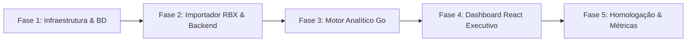

# EVAD - Painel de Inteligência e Retenção para Provedor de Internet (RBX)
**Plano Diretor do Projeto & Diagnóstico Inicial**

---

## 1. Diagnóstico do Ambiente (Varredura do Sistema)

Após a varredura das ferramentas e arquivos no ambiente local, identificamos o seguinte cenário:

### 1.1. Ferramental Instalado
| Ferramenta | Versão Encontrada | Status | Observações |
| :--- | :--- | :--- | :--- |
| **Go** | `go1.27.0 windows/amd64` | Pronto | Backend em Go totalmente suportado |
| **Node.js** | `v24.17.0` | Pronto | Runtime moderno para o frontend |
| **npm** | `12.0.1` | Pronto | Gerenciador de pacotes ativo |
| **Docker Engine / Desktop** | `29.7.2` | Em execução | Docker Compose v5.3.1 disponível |
| **PostgreSQL** | Em container (`solcrm-postgres`) | Atenção na porta | O container `solcrm-postgres` já ocupa a porta local `5432:5432`. Subiremos o PostgreSQL do **Evad** na porta `5433` via Docker Compose para evitar qualquer conflito. |
| **Git** | `2.54.0.windows.1` | Não inicializado | O diretório do projeto ainda não possui repositório Git local (`.git`). Recomenda-se inicializar. |

### 1.2. Estrutura Existente no Workspace (`c:\Users\SOL NOC\Documents\Dev\Projetos\Evad`)
- **`backend/`**:
  - `go.mod` e `go.sum` já configurados com dependências adequadas:
    - `github.com/go-chi/chi/v5` (roteamento HTTP leve e veloz)
    - `github.com/go-chi/cors` (CORS para comunicação com o frontend)
    - `github.com/jackc/pgx/v5` (driver PostgreSQL de alto desempenho com pool de conexões)
    - `github.com/xuri/excelize/v2` (essencial para ler relatórios em Excel/XLSX exportados do RBX)
  - Ainda sem arquivos de código `.go` criados.
- **`frontend/`**:
  - Aplicação Vite criada com template React + TypeScript:
    - React 19 (`19.3.1`)
    - Tailwind CSS v4 (`@tailwindcss/vite` e `tailwindcss 4.3.3`)
    - Lucide React (ícones para dashboard)
    - Recharts (`3.10.1` - biblioteca ideal para gráficos executivos)
    - Dependências instaladas em `node_modules`.

---

## 2. Contexto de Negócio e o Problema RBX

### 2.1. O Cenário
A empresa opera como um **Provedor de Internet (ISP)** e utiliza o **RBX ISP** como ERP central.
- **Limitação do RBX**: O RBX é focado no operacional (emissão de boletos, radius, autenticação PPPoE, abertura de chamados técnicos), mas suas telas e relatórios gerenciais são tabulares, estáticos e não oferecem visualização gráfica analítica de tendências ou inteligência de retenção.
- **A Pergunta Central da Diretoria**:
  > *"Dos clientes que são bloqueados em determinado mês, quantos voltaram para a base (reativaram) e quantos não voltaram (evasão/churn)?"*

### 2.2. A Jornada do Cliente no ISP e a Análise de Bloqueio
Em provedores de internet, o bloqueio por inadimplência é o principal termômetro de risco de cancelamento (*churn* involuntário):
1. **Fatura Vencida (Dia 0)**: Início da inadimplência.
2. **Corte Parcial / Aviso (Dia D+15)**: Redução de velocidade / tela de aviso.
3. **Bloqueio Total (Dia D+30)**: Cliente para de navegar. Aqui se inicia a janela crítica de retenção.
4. **Desfechos Possíveis do Bloqueio**:
   - **Retorno Imediato (0 a 7 dias)**: Pagamento rápido; baixo risco.
   - **Retorno Médio (8 a 30 dias)**: Regularização após negociação ou cobrança ativa.
   - **Retorno Tardio (> 30 dias)**: Cliente volta após acordo ou sazonalidade.
   - **Evasão Definitiva (Churn / Cancelamento)**: Contrato rescindido formalmente ou cliente inadimplente sem sinal de retorno.

O Evad entregará à diretoria uma **Análise de Coorte Mensal de Bloqueios**:
Ao selecionar um mês de referência (ex: *Maio/2026*), o sistema exibirá instantaneamente:
- Total de clientes bloqueados no mês e o montante de receita em risco (MRR).
- Quantos regularizaram e voltaram para a base no próprio mês ou nos meses seguintes.
- Curva de velocidade de retorno (taxa de recuperação em 7, 15, 30 e 60 dias).
- Quantos se tornaram perda definitiva (churn) e o impacto em R$ faturado.
- Segmentação por plano, bairro/cidade e forma de pagamento (se disponível no extrato do RBX).

---

## 3. Estratégia de Ingestão de Dados do RBX

Para que a diretoria tenha acesso aos dados o mais rápido possível, adotaremos uma estratégia em duas fases:

```
[ Relatórios RBX (XLSX / CSV) ]  ───>  [ Módulo Upload / Ingestão ]  ───>  [ PostgreSQL 16 ]
                                                                                  │
[ Futuro: API / Banco Réplica RBX ] ───> [ Sync Automático ] ────────────────────┤
                                                                                  ▼
                                                                     [ Motor Analítico Go (Chi) ]
                                                                                  │
                                                                                  ▼
                                                                     [ Dashboard Executivo React ]
```

1. **Fase 1 (MVP Rápido e Desacoplado - Upload de Planilhas)**:
   - O RBX permite exportar relatórios de:
     - *Clientes Bloqueados / Histórico de Suspensões*.
     - *Títulos / Extrato Financeiro de Cobrança*.
     - *Movimentação de Base (Ativações / Cancelamentos)*.
   - Criamos uma tela simples e segura no Evad onde o gestor ou assistente anexa a planilha do RBX (`.xlsx` ou `.csv`).
   - O backend em Go utiliza `excelize` para processar milhares de linhas em segundos, higieniza os dados e grava no PostgreSQL.
2. **Fase 2 (Sincronização Contínua Automática)**:
   - Conexão direta com a réplica do banco de dados do RBX (ou API do RBX, se contratada/habilitada) via job agendado diário/noturno, eliminando qualquer intervenção manual.

---

## 4. Arquitetura da Solução

### 4.1. Banco de Dados (PostgreSQL 16)
Instância isolada em container Docker:
- **Porta**: `5433:5432` (para não conflitar com `solcrm-postgres` na porta 5432).
- **Modelo de Dados Principal**:
  - `clientes`: Código RBX, nome/razão social, CPF/CNPJ, cidade, bairro, plano contratado, valor da mensalidade (MRR).
  - `eventos_bloqueio`: ID do cliente, data do bloqueio, data do desbloqueio (nulo se ainda bloqueado), motivo, status atual.
  - `contratos_status`: Histórico de status (Ativo, Bloqueado, Cancelado, Isento).
  - `importacoes_log`: Registro de auditoria de cada arquivo importado (data, usuário, total de registros, status).

### 4.2. Backend (Go 1.27)
- **Estrutura Clean & Modular**:
  ```text
  backend/
  ├── cmd/
  │   └── server/
  │       └── main.go              # Inicialização do servidor HTTP e injeção de dependências
  ├── internal/
  │   ├── domain/                  # Entidades (Cliente, Bloqueio, Coorte, Indicadores)
  │   ├── handler/                 # Controllers REST (Upload, Analytics, Dashboard)
  │   ├── service/                 # Regras de negócio e cálculos de retenção/churn
  │   ├── repository/              # Queries SQL otimizadas com pgx/v5
  │   └── importer/                # Parsers de relatórios XLSX do RBX
  ├── migrations/                  # Scripts DDL para tabelas e views do Postgres
  ├── docker-compose.yml           # Subida do Postgres e Adminer (opcional)
  ├── go.mod
  └── go.sum
  ```

### 4.3. Frontend (React 19 + TypeScript + Tailwind v4 + Recharts)
Interface com design executivo profissional, visual limpo, alta legibilidade e foco em tomada de decisão:
- **Visão Geral Executiva (Executive KPI Cards)**:
  - Total de Bloqueados no Mês Selecionado.
  - Taxa de Retorno Global (% e quantidade absoluta).
  - Taxa de Evasão / Churn Derivado (% e quantidade absoluta).
  - Receita Recorrente Recuperada (R$) vs Receita Perdida (R$).
  - Tempo Médio de Regularização (dias).
- **Gráficos Executivos**:
  - **Fluxo de Resolução (Funil / Sankey / Barras Compostas)**: Bloqueados no Mês $\rightarrow$ Regularizados (0-7d, 8-15d, 16-30d, 30d+) vs Permanecem Bloqueados vs Cancelados.
  - **Evolução Histórica Mensal**: Comparativo de taxas de recuperação mês a mês para verificar se as ações de cobrança/suporte estão melhorando.
- **Tabela Detalhada com Filtros Rápidos**:
  - Filtro por mês/ano, por status (Voltou, Não Voltou, Cancelou), por plano ou região.
  - Exportação rápida em CSV/Excel para relatórios de reunião de diretoria.
- **Central de Importação RBX**:
  - Arraste e solte simples de planilhas com barra de progresso e validação de erros.

---

## 5. Cronograma e Fases de Execução



| Fase | Entregas | Prioridade |
| :--- | :--- | :--- |
| **Fase 1: Infraestrutura & Setup** | 1. Criar `docker-compose.yml` para PostgreSQL na porta 5433.<br>2. Definir migrations DDL (tabelas de clientes, bloqueios e importações).<br>3. Inicializar repositório Git. | Imediata |
| **Fase 2: Ingestão de Dados RBX** | 1. Implementar o serviço de importação no Go com `excelize`.<br>2. Criar endpoint de upload com validação de colunas padrão RBX.<br>3. Gerar mock de dados realistas de provedor para testes imediatos. | Alta |
| **Fase 3: Motor Analítico de Coortes** | 1. Queries SQL analíticas de coorte (agrupamento mês de bloqueio x mês de retorno/desfecho).<br>2. Endpoints da API: `/api/analytics/overview`, `/api/analytics/cohort`, `/api/analytics/clients`. | Alta |
| **Fase 4: Dashboard Executivo React** | 1. Configurar layout executivo (TopBar com seletor de período, Cards de métricas).<br>2. Implementar gráficos com Recharts.<br>3. Desenvolver tabela analítica com busca e filtro de status.<br>4. Tela de upload de arquivos RBX com feedback visual. | Alta |
| **Fase 5: Refinamento & Próximos Passos** | 1. Ajuste fino com formatos reais de export do RBX do provedor.<br>2. Preparar arquitetura para futura conexão direta ao banco/API do RBX.<br>3. Suporte futuro a login / controle de acesso quando a diretoria solicitar. | Média |

---

## 6. Decisões Técnicas e Recomendações

1. **Sem Autenticação Inicial (Conforme Solicitado)**:
   - O sistema será direto e acessível na rede local da empresa ou via VPN, sem fricção de telas de login para a diretoria neste primeiro momento.
   - A arquitetura do backend terá uma camada de middleware preparada para receber autenticação (JWT / Sessão) no futuro com mínimo esforço.
2. **Tratamento de Dados de Clientes**:
   - Campos essenciais mantidos com indexação no PostgreSQL (`codigo_rbx`, `data_bloqueio`, `data_desbloqueio`, `status`).
3. **Desempenho**:
   - Cálculos pesados de coorte e métricas de retorno serão processados diretamente no PostgreSQL ou agregados pelo Go, garantindo que o frontend carregue em menos de 1 segundo mesmo com dezenas de milhares de registros.
